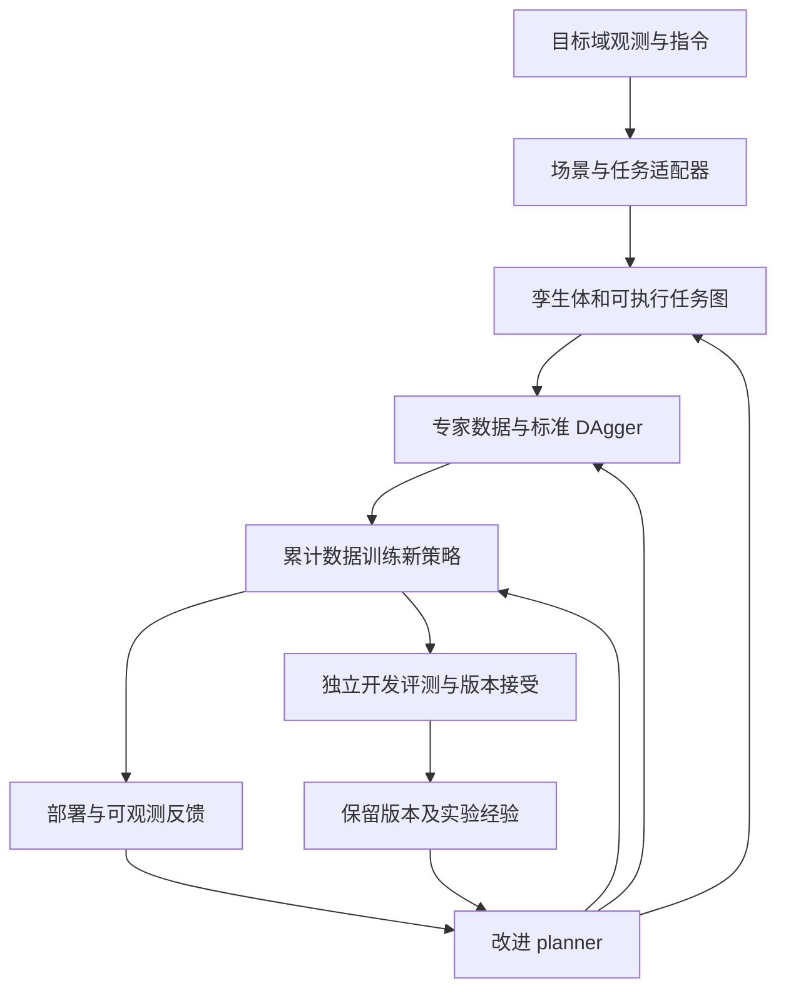

# Agentic Learning Harness：回到部署反馈驱动的 Real2Sim2Real 学习

日期：2026-10-26。依据 v1 组会、v2 原方案、v3/v4 实验和当前代码。资源约束：当前 Windows 笔记本、8GB RTX 5060 Laptop GPU，无机器人或外部 GPU 服务器；CUDA 已通过实际训练验证。本文件区分路线设计与已完成证据；v5–v7 保留为工程与诊断记录，不作为本路线的研究主轴。

**研究问题：给定目标域反馈和有限资源，系统能否自主决定下一轮如何构建有效孪生体、采集训练数据和更新策略，使长程任务的目标域成功率持续提高，并把有效的改进经验迁移到新任务？**

工作标题可用 *Learning from Deployment: An Agentic Real2Sim2Real Harness for Long-Horizon Manipulation*。先用数据验证 learning 与 agent 决策的增益，再决定是否采用更强的 recursive self-improvement 表述。

## 1. 怎样回归原路线

v1/v2 的核心是“学习本身可以 agentic”：任务图、技能、数据生成、执行反馈、下一轮学习形成闭环。v2 §5.5 原本就把状态定义为 policy、sim、task graph、dataset、failure、verifier，动作包括采数、恢复、课程、校准和训练。

v3/v4 发现的是**原先选定的数据分配机制不够好**，并没有否定整个 agentic learning 问题。正确的调整是以标准 β 混合 DAgger 替换不奏效的默认数据分配器，让归因帮助选择学习实验和判断孪生体是否可用。

v5–v7 的固定策略实验回答了修复门槛、调度和证据使用的问题，但无法单独回答“新数据是否使策略学得更好”。继续围绕三个预设错误细调修复器，很容易把整条路线收缩成一个规则控制器。后续每个主实验应有真正的数据生成、权重更新和目标域回测；冻结策略只用作机制消融。

不能为了回归原路线恢复已经不被支持的假设：“子目标归因分配是长程学习的关键变量”仍是负结果。保留原问题、主指标和闭环，更新实现假设。

## 2. 从哪些结果继续，哪些结论暂缓

以下数字均为历史实验，不能当作本方案的新结果。

| 已有结果 | 对新路线的约束 |
|---|---|
| 200k 数据：β-DAgger 82.4% / 77.3%，开环 77.6% / 70.1%；H≥8 为 80.0% / 71.1% 对 67.2% / 58.9% | DAgger 是默认学习工具与必要强基线。恢复成功率—H、成功率—数据预算主图。 |
| 名义衰减率 α：DAgger 0.013，开环 0.044 | 长程闭环学习有实测基础；指数拟合是描述模型，仍要展示各 H 原始成功率和拟合限制。 |
| 归因再生成和 oracle 都没有超过均匀再生成；归因起点 DAgger 也未超过标准 DAgger | 不再默认把采样集中到失败快照；保护策略访问分布和完整任务覆盖。oracle 只给该归因输入作参考，不是所有方法的数学上界。 |
| 有恢复演示在 200k 扰动下比无恢复高 8.7 点；名义差距小 | 保留恢复数据工具，检验何时值得投入，不把已有恢复能力重新包装成新贡献。 |
| v4 的反馈修复改善同 MuJoCo 部署代理，校准后 H4 排序更一致 | 支持“错误 twin 会阻碍学习”的动机；还不能代表真实重建、独立目标域或物理机器人上的闭环有效性。 |
| v5–v7 加入强固定对照、任务库隔离、指纹与资源账目 | 保留这些基础设施；复杂控制器未胜过强对照的结果也保留，不因路线调整删除。 |

来源：[v3](v3_实验进展.md)、[v4](v4_实验进展.md)、[原始主结果](horizon/results/main_v1/RESULTS.md)、[三误差代理](horizon/results/simreal3/RESULTS.md)。旧报告的 pooled-episode 区间不能替代训练种子和共享任务相关性下的新统计分析。

## 3. 可复用代码与真正缺口

### 3.1 已有资产

| 模块 | 已有入口 | 新路线中承担的角色 |
|---|---|---|
| TaskGraph、可行性与状态专家 | `taskgraph/`、`skills/expert.py` | 可执行任务与仿真监督，不要求第一阶段重写专家。 |
| 仿真数据闭环 | `rsi/loop.py:run_method`、`rsi/strategies.py` | 标准 DAgger、恢复与开环工具。 |
| 部署反馈与 twin 更新后训练 | `rsi/simreal.py:run_simreal` | 统一 harness 的现成原型。它已实际训练策略，不是缺少权重更新。 |
| 策略训练 | `rsi/loop.py:train_policy`、`policy/model.py:train_bc` | 首版沿用累计数据从头重训；当前没有 warm-start/优化器续训，先保持可比性。 |
| 场景导入、任务编译 | `real2sim/mjcf_import.py`、`taskgraph/compiler.py` | 外部场景任务入口；后续接自然重建产物。 |
| 显式任务库与版本账目 | `eval/protocol.py`、新训练入口的指纹记录 | 训练、反馈、开发、确认隔离以及配对比较。旧 `run_experiment.py` 尚未统一使用新协议。 |
| CPU rollout 优化 | `datagen/parallel.py`、`sim/state.py`、NumPy policy forward | 保留 worker 单线程 BLAS、几何缓存、worker 不导入 Torch。 |

v4 曾记录 worker 内存约 830→40 MB、单步 1.64→1.55 ms；这是历史测量，不是本次重测或当前速度保证。Markov 专家、噪声容差一致性、抓取碰撞检查和谓词去抖均继续使用。不要通过回滚到旧代码丢掉这些工程修正。

### 3.2 原始缺口及本轮进展

1. **外部任务入口已补。** 原 `Job` 只按 family/H/seed 调用 `make_task`；本轮新增显式任务 payload，并由 E0 验证导入场景能进入训练采集，保留模板任务入口兼容。自然重建输入仍待验证。
2. **没有统一的学习决策接口。** 数据 `STRATEGIES` 与修复 `route` 分立，尚不能用同一 planner 比较“继续 DAgger、补恢复、诊断 twin、训练候选、停止”。
3. **完整 agent 证据接口仍需扩展。** 原 `EpisodeLog` 混有观测、评测真值和模拟器 snapshot；`deploy_and_attribute` 还包含 oracle 诊断。本轮 E1 已为几何工具提取 allowlist 观测并隔离评分，但未来不能直接把原始整个字典交给 planner。
4. **学习版本链已接通，决策链仍待接入。** E0/E1 已记录哪一版 twin 生成哪些数据、训练出哪个 checkpoint，并保存逐轮评测和资源；候选接受理由、planner 与经验记忆版本仍是后续接口。
5. **自然重建闭环没有实证。** 当前 handoff 测试使用上游手工 MJCF fixture；它不等于来自真实视频的重建。导入器还做 box/cylinder 近似、坐标重置及机器人相关组件剥离，是有损适配器。真实重建输入、导入损失、学习和目标域回测必须另行证明。

## 4. Harness 的最小结构

已新增薄的 `horizon/harness/` 层，复用原训练器和模拟器，接通 E0/E1 的固定实验控制器、版本链和资源账目。下面是完整目标合约；通用 tool registry、可学习 planner 和候选接受机制仍未实现，不能由固定控制器的结果推定 agent 优势：

| 合约 | 最小内容 |
|---|---|
| TaskArtifact / SceneAdapter | scene、graph、instruction、原始输入来源及哈希、坐标/单位；目标物理与机器人信念分开。 |
| FeedbackBundle | 可见轨迹、子目标进度、失败摘要、被允许的审计标签；评测真值另存 ScoringRecord。 |
| SystemVersion | policy、twin、graph、judge、dataset、planner 的版本引用与父版本。 |
| Tool registry | typed 输入/输出、先决条件、资源消耗、失败记录；调用现有函数。 |
| Planner | `propose(context) -> plan`；固定配方、规则控制器、模型/学习型控制器共用工具和预算。 |
| Experiment runner | 执行、断点恢复、候选评测和不可变 round journal；确认集不作为 planner 工具。 |

首版工具只开放：部署反馈、twin 比较/校准、标准 DAgger、预定义恢复数据配方、训练、开发评测、停止。图和判定器修复继续作为可选工具，在需要时启用；不要求每个任务都注入三类错误。暂不开放任意代码自改、任意成功定义修改或无预算候选搜索。

第一版先用固定配方和规则 planner 验证运行接口。若后续使用语言模型 planner，记录实际模型版本、输入、工具调用、候选与调用成本；没有真实运行模型或可学习控制器时，不把脚本回放称为已验证的 agent 决策优势。本机不预设有可用大模型或付费 API。

数据记录最少保留：`episode_id, scene_hash, graph_hash, policy_hash, twin_hash, provenance, split`。仿真特权专家可以标注，但标签只通过训练工具进入 dataset；真实部署不能直接复制目标域的隐藏物理状态作为“重建”。

## 5. 实验路线：先证明学习链，再证明 agent 的选择有价值

### E0：工程闭环，不用小样本成功率讲故事

本机先跑一个 H=2 外部场景任务：导入/显式 SceneSpec→编译→专家数据 D0→训练 π0→β 混合采集→累计数据 D1→训练 π1→独立开发 rollout。保存输入、数据和模型哈希、训练步数、失败及资源账目。

先用 fixture 验证入口，必须标明合成来源；随后需要新布局/物体实例分离的任务集合。重复一个场景且只换噪声种子不算场景泛化。至少一次训练前后要有真实梯度更新、数据新增以及相应 checkpoint；哈希变化只证明状态改变，不证明学习有效。

通过条件：worker 确实使用外部任务；序列化和 Windows spawn 可运行；预算/数据来源可追踪；训练与回测通路畅通；中断不会覆盖旧版本。无需先完成 ACT/DP、全技能库或第二模拟器。

### E1：孪生更新与策略学习的 2×2——回到 v3/v4 的核心问题

| | 策略冻结 | 在累计数据上继续 β-DAgger 学习 |
|---|---|---|
| twin 固定 | 初始系统 S00 | 固定 twin 学习 S01 |
| twin 按部署证据更新 | 仅系统校准 S10 | 校准＋学习 S11 |

先固定 task graph 和 judge，研究一个几何/接触相关的 twin 更新，避免三类结构修改同时发生。同引擎注入偏差作为可控机制条件，另保留无偏差条件；不能只选择能把 DAgger 压到 0 的设置。

每个种子共享物化的 D0 和初始 π0，不从已训练到 200k 的最终 checkpoint 起步冒充 80k 学习起点。现有数据池若未保存，应重新生成一次并缓存，不把“相同随机种子”当成已证明字节相同。首个可比较协议沿用 80k＋3×40k transitions、每次 8000 训练步和现有结构；先用小型运行测资源，正式使用该预算前冻结配置。

训练组共享 200k 数据上限和训练步数；冻结组实际不训练，不浪费算力伪造预算匹配，也不据此比较训练效率。它们是机制对照。

把每轮总改进拆成两项，开发任务与扰动身份固定：

- 即时系统收益：`J(π前, twin后) − J(π前, twin前)`。
- 权重学习收益：`J(π后, twin后) − J(π前, twin后)`。

这里 twin 包含被更新的机器人几何信念；评分始终在同一目标域、使用不随算法修改的真值规则。额外诊断评测单独计数，不把其隐藏真值喂给 planner。若要声称二者协同，还需报告交互项 `S11 − S10 − S01 + S00`；完整组胜出不自动等于正交互。

先 pack，H=2/4，3 个训练种子做开发；学习信号和代价合理后，扩到 pack/sort/stack × H=2/4/6/8/10。冻结后再按开发方差决定独立训练重复数和确认规模。新开发任务库与所有已查看集合隔离，不打开现有确认库调参。

**失败判据：**若 S11 没有额外权重学习收益，或只靠更新信念即可达到相同表现，就不能用这个设定证明 agentic learning 的联合价值。先诊断数据/目标域条件，不通过调更多修复阈值掩盖结果。

### E2：同工具同预算，agent 是否会选更好的学习实验

E1 证明闭环链有价值后，再引入 agent 决策；它是候选贡献，不能由“工具都接好了”直接推出。

最小主比较：

1. 固定标准 β-DAgger：twin 不更新。
2. 开发集选好的固定“校准＋DAgger”配方，允许预设恢复混合比例。
3. 简单规则 planner：依据同一份可见反馈选择工具。
4. agent/学习型 planner：可用工具、预算与规则基线一致。

第 1 组隔离有无 twin 更新；真正检验决策能力的是第 4 组对第 2/3 组。固定配方的搜索成本也计入开发成本。随机选择可作为补充，不能是主要对手。

任务分布应含不同学习需求：名义覆盖不足、扰动恢复不足、自然或受控 twin 偏差、已足够好无需更新。由预先定义的场景和扰动生成，不向 planner 提供 condition 标签，也不根据哪个设置能让 agent 赢来筛选。各方法得到同样反馈机会与初始系统。

主指标恢复为 **目标域全任务成功率随 H、数据/部署预算和学习轮数的变化**。先选一个主预算轴，同时报告其他实际资源。只有 agent 在未见开发/确认场景优于最强固定配方或在预定义性能容忍范围内节约资源，才能声称自适应学习决策有独立价值。

关键消融只做两项起步：取消子目标细分（保留整任务反馈）；取消跨任务实验记忆。不要一次叠加新技能、大模型、视觉、多个修复算子后把总增益归因于 planner。

### E3：把原 H5 变成改进经验的迁移

先区别两种复用：已有 policy/数据复用降低新任务成本，和 improver 学会更有效地选择学习行动。旧 H5 主要覆盖前者，且限于 pick_place 的任务族。

在若干开发场景积累实验经验后，冻结工具、planner/prompt/记忆，再到新场景和新组合。比较初始 improver、带历史经验的 improver、开发阶段选出的最佳固定配方。各组使用相同初始 actor 和反馈预算；不能让有记忆组同时额外获得预训练权重却把收益全部归给记忆。

报告达到预先定义目标性能的部署次数、专家标签、训练量与人工介入；未达到者不能丢弃，报告达标比例和删失。评估旧任务保持率。只有 pick_place 时称跨场景/组合迁移，不称跨技能。

“部署→再学习→再部署”可作为操作性 RSI；若进一步声称改进器自身递归变强，则需比较冻结的旧/新 improver 在全新任务上的改进效率。无需为满足术语先做自动改代码。

## 6. Real2Sim2Real 的证据如何逐级补齐

| 层级 | 当前笔记本能推进的内容 | 能支持的结论 |
|---|---|---|
| A：可控 MuJoCo 代理 | 完整学习与 agent 决策接口、受控偏差、长程曲线 | 方法机制与软件可复现性；不是真机迁移。 |
| B：独立目标模拟器 | PhysX CPU 上先实现相同浮动夹爪和 pack/H=2，匹配动作/观测/评分 | 独立物理实现下的迁移；与视觉泛化分别分析。 |
| C：自然真实重建输入 | 获取有来源的实拍与重建产物，量化导入损失并接训练；本地先做代理几何适配 | 真实输入到仿真学习的链路；没有物理机器人回测时仍不是完整 R2S2R 性能证据。 |
| D：物理机器人部署 | 未来获得机器人后，在同任务上复测学习前后策略 | 完整 Real2Sim2Real；当前资源下尚不能完成此层。 |

独立后端不应成为 E0/E1 的前置条件，也不能永远停留在 PickCube 的随机冒烟。优先复用浮动夹爪，避免为了一个末端接口先引入 Panda IK 和形态差异。若采用其他机器人，必须把它列为新增变量。

当前已验证 CUDA 可用；状态 BC 使用 GPU 训练，MuJoCo rollout 使用 CPU。8GB 显存不等于完整 Agentic RSR 的 Linux 前端或大型 VLA 已可运行。视觉路线先利用已有 RGB/action 导出，验证轻量视觉 BC 或一种 ACT/DP 的数据与单批次训练，再跑闭环；换 backbone 是扩展验证，不是主贡献。

H4 放在 B/D 层有对应目标域之后验证：校准任务、排序任务、候选系统分离；报告 Spearman/Kendall、排序错误、成功率预测误差及分组不确定性。校准用的 ρ 或同引擎完美排序不能直接担保它可替代部署评测。

## 7. 预算、公平性与本机执行方式

以资源向量记录：目标域反馈 episode/时长、审计 episode/关键帧/标签、仿真物理步、专家标签 transitions、优化步/样本呈现数、模型调用、墙钟和峰值内存。不用任意 1/3/2 算子费用代替实际学习成本。

agent 的候选训练、失败生成、拒绝候选、额外 twin rollout 全部收费。`route=none` 当前会跳过反馈，因此不能直接把旧 sim_only 配置叫作全资源匹配；新 harness 应统一预算机会，并如实报告不用反馈所节省的资源。固定数据量只保证一个维度可比。

本轮实测配置：一个实验进程、8 个 rollout worker、worker 单线程 BLAS、CUDA FP32 trainer。E1 的 42 次训练累计约 780 秒，8000 步训练每次约 15.7–22.1 秒，PyTorch 峰值 allocated 约 157.8 MiB；这些数值不含完整端到端采样、启动和产物开销，也不是整个 GPU 进程的显存峰值。保留 NumPy inference、几何缓存和共享 D0。warm-start、混合精度等优化需另行验证，不与算法收益混算。

主性能结论从独立训练种子推断，同时利用共享任务的配对结构；所有 H 都报告，不只挑 H≥8。开发/确认按实际场景和物体身份隔离，种子不相交只是最低要求。

## 8. 实施顺序与退出条件

| 顺序 | 具体交付 | 决策 |
|---|---|---|
| 1 | 外部 TaskArtifact→worker；D0/π0→DAgger→D1/π1 的学习冒烟；版本和资源记录 | 接口和训练链通过后，进入机制实验。 |
| 2 | E1 的 2×2 和逐轮即时/学习收益分解 | 无新增学习收益时先修数据链或调整有根据的任务条件，不进入 planner 军备竞赛。 |
| 3 | E2 同工具固定/规则/agent 比较，恢复 H/预算曲线 | agent 无收益则保留透明 harness 与强固定基线，暂不主张 agent 决策贡献。 |
| 4 | 一个独立目标域的同任务闭环，补自然重建来源 | 跨域收益不能只由替换评分或直接拷贝真值造成。 |
| 5 | E3 经验迁移；后续视觉/新技能/机器人 | 依据前面已成立的机制逐项扩展，不作为一开始的全部依赖。 |

主论文图应是学习曲线、2×2 机制图、agent 对强固定配方的增益、迁移成本曲线。修复命中、阈值和内部拒绝统计放到机制分析与附录。

## 9. 本轮落实范围

已完成显式任务 payload、产物保存与验证、学习 harness、E0 合成外部场景训练闭环，以及 E1 的 24/24 个运行、72/72 个轮次。完整回归 **109 passed in 10.44s**；独立产物校验通过。E0 的微小训练预算只证明通路可运行。实现和命令见 [harness 说明](horizon/docs/learning_harness.md)，性能矩阵见 [E1 结果](horizon/results/harness_e1_20261026/RESULTS.md)。

E1 的偏差条件中，S11 完整 SR 为 94.17% / 91.67%（名义/扰动，三种子均值），但 S10 一个种子发生了重复校准失效；其与 S11 的最终差距不能全部叫纯学习收益。该失败的原始证据和重算见 [几何诊断](horizon/results/harness_e1_20261026/GEOMETRY_DIAGNOSTIC.md)。固定首轮 belief 的事后诊断仍有 +34.17 / +30.83 个百分点的配对学习提升，但使用已查看开发集，不是独立确认。

健康 H2/4 接近饱和；已完成的 H6/8/10 外推诊断则是24个系统、2880次评测全部完整SR为0。固定六个任务的专家检查12/12成功。短程训练的长度外推同时改变特征占用、布局和拥挤程度，不能当作纯长度效应，不能替代原先全H训练的 scaling。完整正负结果、实际资源和下一批必要对照见 [本轮实验记录](实验记录_学习闭环_2026-10-26.md)。

下一项主实验仍是 pack/sort/stack × H=2/4/6/8/10 的学习与预算曲线，采用足够强的固定学习配方后再比较 planner。E2/E3、自然真实重建、独立目标域训练、物理机器人及 RoboDojo 实跑尚未完成。[RoboDojo 可选附录](horizon/docs/robodojo_appendix.md) 固定 Score/SR/ρ 的区分，并列出当前接口与运行资源的未核实项。

v1–v4 作为问题和实验依据保留；v5–v7 的结果不删除，工程改进不回滚。前一份 [研究决策补充](研究决策补充_2026-10-26.md) 针对旧评审中的因果断言，本文件按新的用户目标重新设定主路线。
